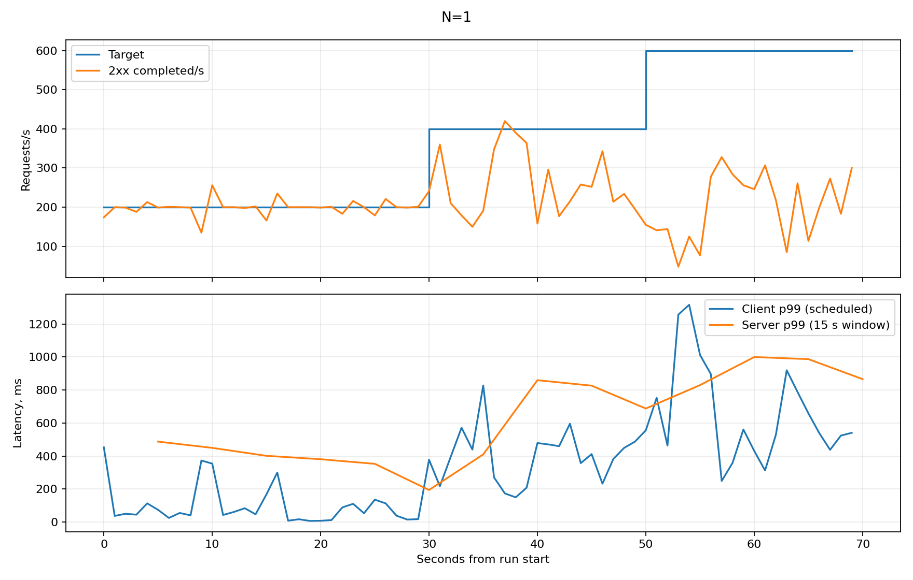
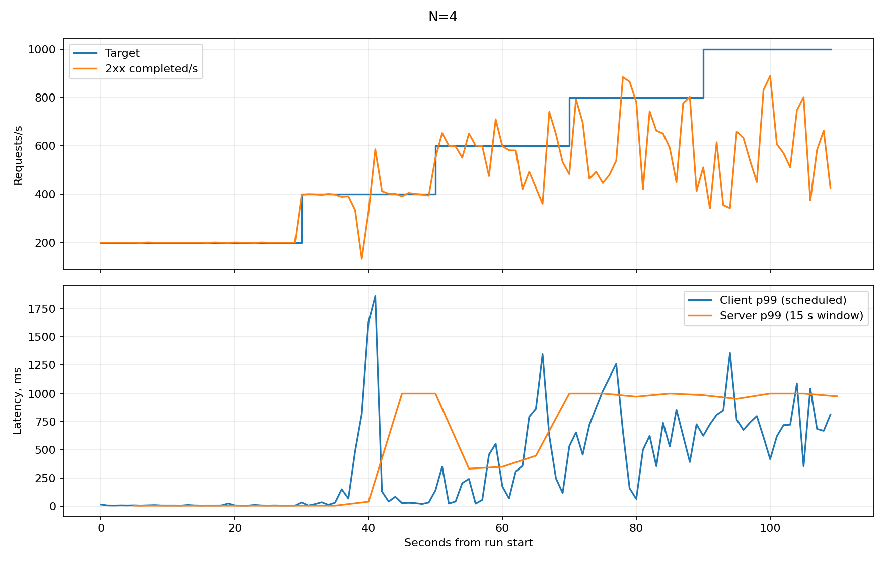
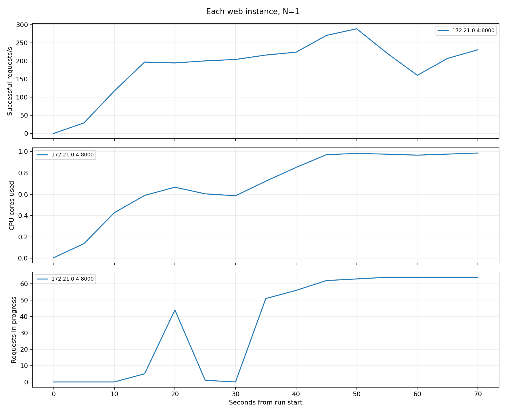
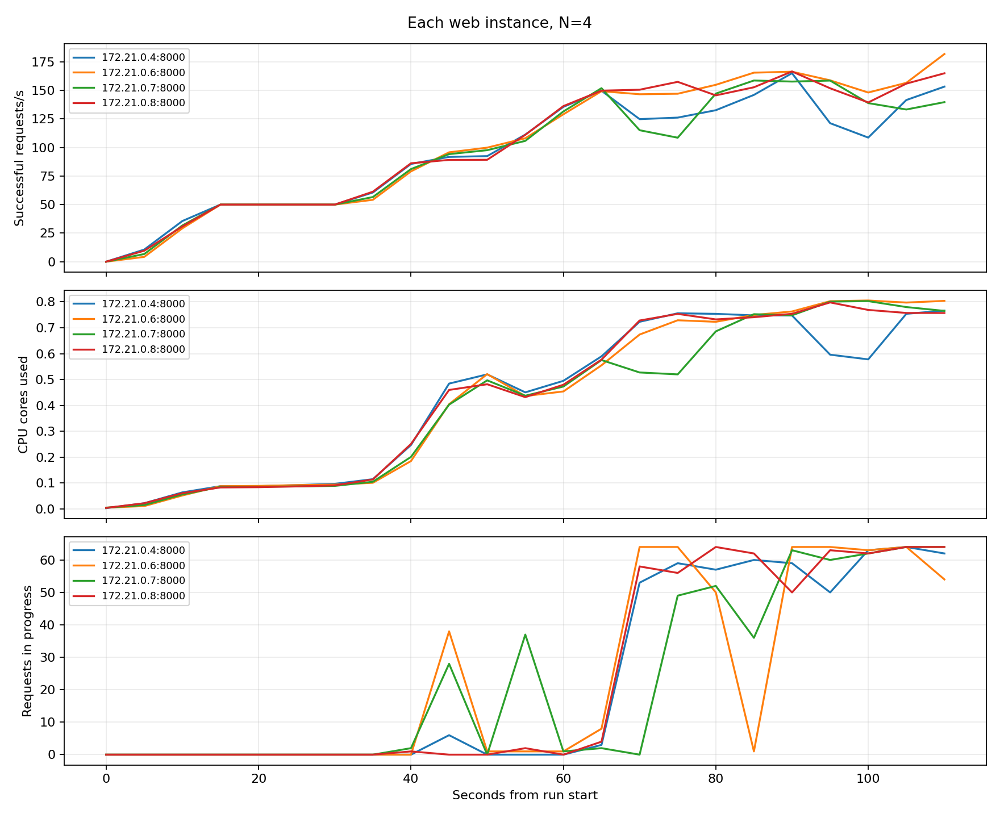
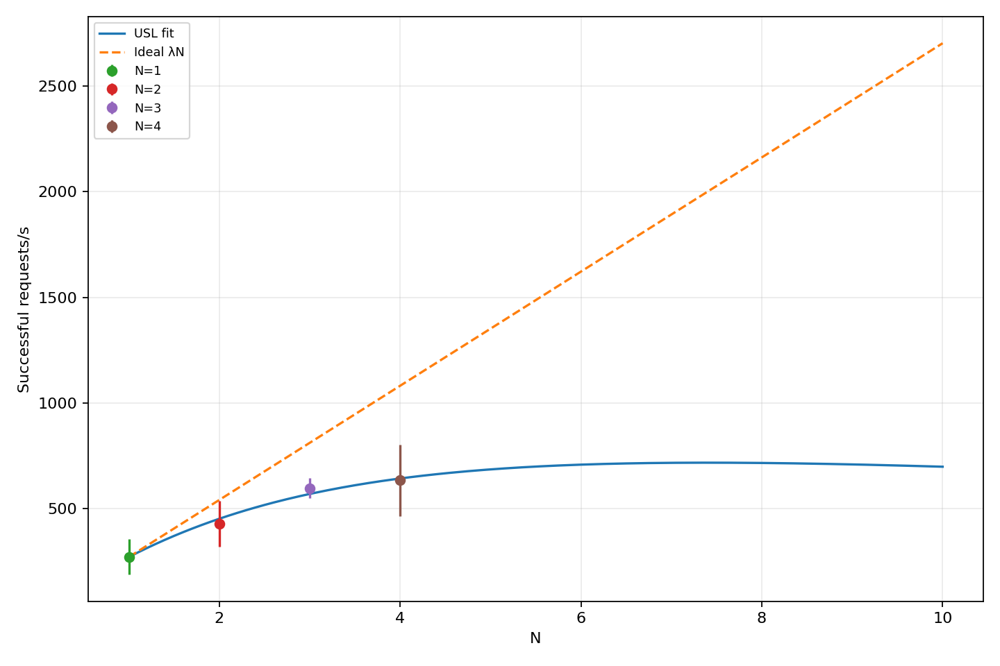
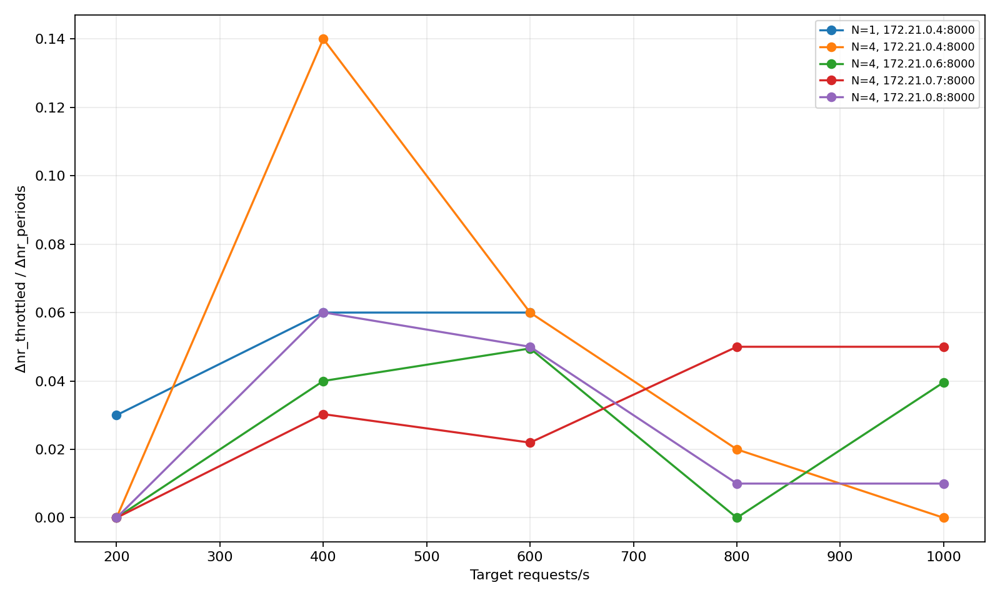

# Лабораторна робота 2. Метрики сервісу і межа масштабованості

Варіант 7. Дьяченко Валерія, група ЗК-61мп.

Дисципліна «Високопродуктивні розподілені обчислювальні системи».

## Мета роботи

Додати до сервісу записів про вакцинацію метрики Prometheus, виміряти його пропускну здатність і затримку ступінчастим навантаженням на одному, двох, трьох і чотирьох екземплярах та за результатами визначити параметри універсального закону масштабованості.

## 1 Перенесення сервісу та умови експерименту

З першої роботи я перенесла таблицю `vaccinations` і CRUD API `/vaccinations`. Поля запису, фільтр за вакциною, пагінація та правила валідації (номер дози від 1 до 4, дата введення не пізніше поточної) лишилися без змін. Дані зберігаються в PostgreSQL, схема створюється автоматично. Для другої роботи використано окремий проєкт Compose `vaccinations-pr2`, файли першої роботи в її репозиторії не змінювалися.

Два worker Gunicorn із першої роботи замінено одним процесом Starlette/Uvicorn: за умовою в контейнері має працювати один процес сервісу, та й CPU такого процесу простіше виміряти. Запити до PostgreSQL виконуються через асинхронний пул.

| Параметр | Значення |
|---|---|
| Комп’ютер генератора | Windows, 8 логічних CPU, приблизно 6.96 ГіБ оперативної пам’яті |
| Docker Desktop | 8 CPU, 3.311 ГіБ пам’яті |
| Docker Compose | v5.6.0 |
| Ліміт кожного web | 1.5 CPU, 1 ГіБ пам’яті (з варіанта лабораторної роботи 1) |
| Процесів сервісу на контейнер | 1 |
| Максимум з’єднань PostgreSQL на web | 15 |
| Межа одночасних CRUD-обробників на web | 64 |
| Генератор | 2 процеси з асинхронним HTTP-клієнтом |
| Сценарій | GET `/vaccinations/101` через Nginx |
| Сервер і генератор | На одному фізичному комп’ютері |

Перед серією я додала 100 записів з ідентифікаторами 101–200 (вони збережені в `results/seed.json`). Нумерація почалася зі 101, бо том бази містив записи попередніх запусків, і таблицю перед серією не очищували. Тобто в таблиці було більше ста записів, а для читання в усіх прогонах використано один і той самий запис 101.

Це спрощення сценарію, і про нього варто пам’ятати. Постійне читання одного рядка означає, що PostgreSQL щоразу віддає його з кешу, тож реальне навантаження на базу при читанні різних записів могло бути трохи більшим. Для порівняння кількості екземплярів між собою це не критично, бо всі чотири прогони виконано за однакових умов. Але абсолютні значення X(N) відносяться саме до цього сценарію.

Початковий ліміт 1.5 CPU збережено для всіх чотирьох прогонів. Зменшувати CPU і повторювати серію не довелося: генератор встигав надсилати запити, і жодна точка не виявилась обмеженою генератором.

## 2 Метрики та обробка запитів

Метрики створюються один раз при запуску застосунку. На початку кожного запиту лічильник активних запитів збільшується, після відповіді зменшується, а код відповіді й час обробки записуються в метрики. Мітка шляху для читання одного запису має вигляд `/vaccinations/{id}`: конкретні ID в мітку не потрапляють, тому Prometheus не створює окремий ряд для кожного запису.

| Метрика | Призначення |
|---|---|
| `http_requests_total{method,path,code}` | Кількість завершених відповідей за методом, шаблоном шляху і кодом |
| `http_request_duration_seconds` | Гістограма часу обробки запиту сервером |
| `http_requests_in_progress{path}` | Кількість запитів, які ще обробляються |
| `process_cpu_seconds_total` | Накопичений процесорний час сервісу |
| `cgroup_cpu_nr_periods_total` | Кількість періодів квоти CPU контейнера |
| `cgroup_cpu_nr_throttled_total` | Кількість періодів з обмеженням CPU |
| `service_info{pod}` | Ім’я екземпляра для зіставлення з адресою цілі Prometheus |

Для варіанта 7 використано бакети Г1: 5, 10, 25, 50, 100, 250, 500, 1000 мс. У метриках вони записані в секундах. Звернення до `/metrics` у гістограму HTTP не потрапляють. Запити готовності мають власну мітку шляху і не змішуються з `/vaccinations/{id}` у розрахунках навантаження.

`GET /livez` повертає 200 без звернення до PostgreSQL. `GET /healthz` виконує `SELECT 1` і при недоступності бази повертає 503. Заголовок `X-Pod` додається до кожної відповіді: значення береться зі змінної `POD_NAME`, а якщо її не задано, то з імені хоста контейнера.

Для кожного екземпляра створюється один `AsyncConnectionPool` з `max_size=DB_POOL_SIZE`, у Compose задано 15. З’єднання понад цей максимум не відкриваються, тож для чотирьох web верхня межа становить 60 з’єднань. Перед виконанням SQL перевіряються обов’язкові поля, тип дози, дата і рядкові значення, а керівні символи в рядках заборонені. Некоректні дані дають 400, а недоступність з’єднання або перевищення часу очікування пулу дають 503.

Кількість одночасних CRUD-обробників обмежено 64 на екземпляр. Коли всі зайняті, новий запит одразу отримує 503 з повідомленням `Черга запитів заповнена`. Такі відповіді рахуються як не-2xx. Задана інтенсивність генератора через це не зменшується. `/metrics`, `/livez` і `/healthz` проходять окремо від цієї черги. Nginx не повторює відповіді 503 на іншому web, щоб під час перевантаження не створювати додаткових запитів.

Ліміт у 64 обробники я додала сама, у завданні його немає. В умові запити під час перевантаження накопичуються в черзі, а час відповіді зростає. У моєму сервісі черга обмежена, і надлишок відсікається через 503. Тому після насичення видно не лише зупинку зростання досягнутої інтенсивності, а й її падіння (для N=1 з 270.333 до 227.267 rps), а затримка на високих сходинках обмежена зверху. На X(N) саме падіння не впливає, бо X(N) береться як максимум за прогін. Але p99 і частка не-2xx на сходинці максимуму залежать від цього ліміту, і це треба враховувати при читанні таблиць нижче.

## 3 Prometheus і пошук екземплярів

Стенд складається з PostgreSQL, web, Nginx і Prometheus. Дані бази та Prometheus лежать у різних іменованих томах. З комп’ютера доступні Nginx на порту 18081 і Prometheus на порту 19090, а порти web і бази відкриті лише всередині Docker.

Конфігурація збору:

```yaml
global:
  scrape_interval: 5s
  scrape_timeout: 4s
  evaluation_interval: 5s
scrape_configs:
  - job_name: web
    metrics_path: /metrics
    dns_sd_configs:
      - names: [web]
        type: A
        port: 8000
        refresh_interval: 5s
```

Після кожної зміни кількості web балансувальник перезапускався. Навантаження я починала лише тоді, коли Prometheus знаходив усі потрібні екземпляри. Відповідь API Targets для чотирьох екземплярів збережено в `results/cpu-1.5/targets-4.json`:

| Ціль | Екземпляр за X-Pod | Стан |
|---|---|---|
| `172.21.0.4:8000` | `1b60a105b1e7` | UP |
| `172.21.0.6:8000` | `9057c30da552` | UP |
| `172.21.0.7:8000` | `b27888bc8a8e` | UP |
| `172.21.0.8:8000` | `6a1e2f932d2e` | UP |

## 4 Ступінчастий профіль і спосіб обчислення

Генератор працює у двох процесах, між якими поділено спільний розклад запитів. Для відправки використано `aiohttp`. Кожен запит іде у запланований момент, не чекаючи відповіді на попередній. Ліміт з’єднань клієнтського пулу вимкнено. На Windows після пробудження таймера годинник перевіряється ще раз, щоб запит не пішов раніше запланованого часу.

Прогрів триває 10 с на 200 rps. Далі йдуть сходинки по 20 с: 200, 400, 600 rps і так далі. Перші 5 с кожної сходинки відкидаються. Прогін завершується після двох сходинок поспіль з досягнутою інтенсивністю нижче 90% заданої або після сходинки, що досягла межі генератора G.

Для кожної секунди записуються задана інтенсивність, фактична відправка, кількість відповідей 2xx і не-2xx, тайм-аутів і помилок з’єднання, а також p50, p95 і p99. Затримка клієнта відраховується від запланованого моменту до повного читання відповіді. Тайм-аут становить 5 с і рахується як не-2xx.

Для X(N) беруться лише відповіді 2xx за останні 15 с сходинки. З 15 посекундних значень обчислюється середнє, і X(N) дорівнює найбільшому такому середньому за прогін. Розкид це вибіркове стандартне відхилення тих самих 15 значень. Клієнтські перцентилі в підсумковій таблиці пораховано за відповідями, завершеними в цьому ж вікні. Для кожного N виконано один прогін, повторні прогони не усереднювалися.

Сирі дані запитів лежать у `results/cpu-1.5/run-N.json`, посекундні таблиці в `seconds-N.csv`. Таблиці в `RESULTS.md` і графіки побудовано скриптом `scripts/analyze.py`.

## 5 Калібрування генератора

Калібрування виконано через той самий порт Nginx на шляху `/noop`, для якого балансувальник одразу повертає 204 і до web не звертається. Збережено 762000 відповідей 204, помилок у цьому прогоні не було. У таблиці наведено вибірку сходинок, а не всі.

| Ціль, rps | Досягнуто, rps | Відправлено, rps | p95 відставання від розкладу, мс |
|---|---|---|---|
| 200 | 200.000 | 200.000 | 1.719 |
| 800 | 800.000 | 800.000 | 1.177 |
| 1600 | 1600.133 | 1600.000 | 1.181 |
| 2400 | 2399.933 | 2400.000 | 25.684 |
| 2600 | 2598.200 | 2599.067 | 17.682 |
| 2800 | 2671.200 | 2681.933 | 613.119 |
| 3000 | 2818.133 | 2817.600 | 2481.993 |
| 3200 | 3039.533 | 3033.133 | 3610.992 |
| 3400 | **3138.267** | 3149.933 | 6084.483 |
| 3600 | 2620.867 | 2624.800 | 9044.074 |
| 3800 | 1839.000 | 1843.667 | 12550.689 |

Найбільша середня досягнута інтенсивність дорівнює 3138.267 rps. За умовою це і є межа генератора: **G = 3138.267 rps**. На сходинках 3600 і 3800 досягнуто менше 90% цілі, тому калібрування на цьому зупинилося.

На високих сходинках генератор уже відставав від розкладу, тобто стабільні 3400 rps він не тримав, хоча саме там отримано максимум G. В основних прогонах це не заважало: найбільша задана інтенсивність була 1000 rps, а p95 відставання відправки в усіх чотирьох прогонах не перевищив 8.532 мс. Критерій з умови 0.9G = 2824.440 rps значно вищий за всі отримані X(N).

## 6 Пропускна здатність на 1–4 екземплярах

| N | X(N), rps | Розкид, rps | Сходинка максимуму, rps | p99 клієнта, мс | p99 сервера, мс | Не 2xx, % | CPU одного web, ядер | Запити в обробці на web |
|---|---|---|---|---|---|---|---|---|
| 1 | 270.333 | 84.010 | 400 | 634.576 | 688.047 | 32.686 | 0.983 | 60.333 |
| 2 | 427.800 | 108.469 | 600 | 676.585 | 880.512 | 28.732 | 0.938 | 62.667 |
| 3 | 596.733 | 46.576 | 600 | 374.828 | 472.642 | 0.533 | 0.774 | 17.000 |
| 4 | 633.867 | 168.497 | 800 | 910.938 | 985.781 | 21.233 | 0.753 | 51.500 |

CPU в таблиці це середнє по екземплярах значення `rate(process_cpu_seconds_total[15s])` наприкінці вибраного вікна, де 1 означає одне повністю зайняте ядро. Запити в обробці усереднено за 15 с і за web. Знімок `docker stats` нижче показує один момент часу, тому його значення можуть відрізнятися від середніх у таблиці.

Приклад для одного екземпляра: на сходинці 400 rps за останні 15 с завершено 4055 відповідей 200, тож X(1) = 4055/15 = 270.333 rps. У тому ж вікні було 1969 відповідей 503, і їхня частка дорівнює 1969/(4055+1969)×100% = 32.686%.

В основних прогонах були тільки коди 200 і 503. Усі 503 містили повідомлення про заповнену чергу. Тайм-аутів, помилок з’єднання та 504 у цій серії не було, тобто частина запитів отримала відмову 503, але не втрачалася.

| N | Остання ціль, rps | Досягнуто на останній сходинці, rps | 90% цілі | Точка обмежена генератором |
|---|---|---|---|---|
| 1 | 600 | 227.267 | 540 | Ні |
| 2 | 800 | 353.933 | 720 | Ні |
| 3 | 1000 | 394.667 | 900 | Ні |
| 4 | 1000 | 619.000 | 900 | Ні |

Усі X(N) нижчі за 0.9G, а на останніх сходинках 90% цілі не втримано, тому в підбір моделі пішли всі чотири результати.

На трьох web інтенсивність 600 rps майже втримано: 596.733 rps і лише 0.533% неуспішних відповідей. Четвертий web підняв максимум до 633.867 rps, але на цій сходинці вже 21.233% запитів завершилися помилкою. Тобто на сходинках із найбільшою кількістю успішних відповідей частина запитів уже отримувала відмову.

## 7 Розподіл запитів і часові діаграми

Відповіді пораховано за `X-Pod` у сирих даних запитів. У таблиці враховано всі сходинки прогону, а відповіді, завершені під час прогріву й після кінця профілю, до неї не потрапили.

| N | X-Pod | Відповідей |
|---|---|---|
| 1 | `1b60a105b1e7` | 23988 |
| 2 | `1b60a105b1e7` | 19926 |
| 2 | `9057c30da552` | 19928 |
| 3 | `1b60a105b1e7` | 20402 |
| 3 | `9057c30da552` | 19872 |
| 3 | `b27888bc8a8e` | 19589 |
| 4 | `1b60a105b1e7` | 14365 |
| 4 | `6a1e2f932d2e` | 15243 |
| 4 | `9057c30da552` | 15242 |
| 4 | `b27888bc8a8e` | 14687 |

На чотирьох екземплярах кожному дісталося приблизно 24.1–25.6% відповідей, тобто навантаження отримували всі web. Логи знято з `--since` окремо для кожного прогону, і в `lb-4.log` перші та останні часові мітки належать саме серії на чотирьох екземплярах.

Діаграми побудовано з даних Prometheus і генератора до видалення томів Compose. На рисунках показано задану й досягнуту інтенсивність за секунду, p99 клієнта за секунду і p99 сервера за ковзне вікно 15 с з кроком 5 с. Перші 10 с на них це прогрів, у підсумкові X(N) він не входить.



Один web уже на 400 rps не встигав обробляти всі запити. Перехід до 600 rps пропускну здатність не підняв, а навпаки знизив: середня досягнута інтенсивність впала з 270.333 до 227.267 rps. Одночасно зросли затримка та частка відмов.



Чотири web добре справлялися з меншим навантаженням, але на 800 і 1000 rps теж не встигали за заданою інтенсивністю. Посекундні значення сильно коливалися, що видно й за розкидом X(4) = 168.497 rps.





На високих сходинках кількість запитів в обробці наближається до межі 64. Коли обробники заповнені, нові запити отримують 503, тому далі це число вже не росте.

## 8 Порівняння p99 і похибка гістограми

Для кожної сходинки на одному web використано прирости бакетів за останні 15 с, просумовані по екземплярах. Значення `increase` можуть бути дробовими, бо Prometheus оцінює приріст за все вікно за окремими моментами збору метрик.

| Ціль, rps | p99 клієнта, мс | p99 сервера, мс | Бакет сервера, мс | Максимальна похибка, мс |
|---|---|---|---|---|
| 200 | 271.188 | 194.255 | (100, 250] | 150 |
| 400 | 634.576 | 688.047 | (500, 1000] | 500 |
| 600 | 837.506 | 866.094 | (500, 1000] | 500 |

Приклад для 400 rps: загальний приріст `_count` становив 5991.896759, тож ранг r = 0.99 × 5991.896759 = 5931.977791. До межі 0.5 с накопичено 5895.858343 спостереження, до 1 с — 5991.896759. Отже:

`Q(0.99) = 0.5 + (1 − 0.5) × (5931.977791 − 5895.858343) / (5991.896759 − 5895.858343) = 0.688047 с`.

На 200 rps клієнтський p99 вищий за серверну оцінку на 76.933 мс, і це очікувано, бо клієнт додатково враховує мережу та чергу в Nginx. На 400 і 600 rps картина зворотна: оцінка сервера вища за клієнтський p99 на 53.471 і 28.588 мс. Фізично серверний час не може перевищувати клієнтський, тож тут бачимо похибку самої гістограми. Значення потрапило в бакет (500, 1000], а Prometheus розташовує його всередині бакета за лінійною інтерполяцією, ніби спостереження розподілені рівномірно. Реальний p99 може лежати де завгодно в межах 500 мс, тому різниця в 53 і 29 мс повністю вкладається в цю похибку. Точніше порівняти p99 на цих сходинках бакети Г1 не дозволяють, і саме це демонструє цей крок.

У цих трьох вікнах p99 не вийшов за останню скінченну межу. Якби ранг перевищив 1000 мс, результат довелося б записати як «> 1000 мс», бо верхня межа похибки тоді не обмежена.

## 9 Параметри універсального закону масштабованості

Використано модель:

`X(N) = λN / [1 + σ(N−1) + κN(N−1)]`, де `λ = X(1) = 270.333333 rps`.

Для N>1 обчислено `C(N) = X(N)/X(1)`, `u = N−1`, `v = N(N−1)` та `y = N/C(N) − 1`.

| N | C(N) | u | v | y |
|---|---|---|---|---|
| 2 | 1.582491 | 1 | 2 | 0.263830 |
| 3 | 2.207398 | 2 | 6 | 0.359066 |
| 4 | 2.344760 | 3 | 12 | 0.705932 |

Суми: `Σu² = 14`, `Σv² = 184`, `Σuv = 50`, `Σuy = 3.099758043`, `Σvy = 11.153239220`.

Знаменник: `D = 14×184 − 50² = 76`.

`σ = (184×3.099758043 − 50×11.153239220) / 76 = 0.167019986`

`κ = (14×11.153239220 − 50×3.099758043) / 76 = 0.015229565`

Обидва коефіцієнти додатні, тому однопараметричний перерахунок не потрібен.

`N* = √((1−σ)/κ) = √((1 − 0.167019986)/0.015229565) = 7.3956`



За моделлю максимум пропускної здатності очікується при N* ≈ 7.40. Але виміряно лише N=1…4, на семи чи восьми web запусків не було, тож цей прогноз ще треба перевіряти. До того ж для N=1, 2 і 4 посекундні значення помітно коливалися навіть у межах одного прогону, а це знижує точність підбору на трьох точках.

Якби пропускна здатність росла прямо пропорційно кількості екземплярів, вона дорівнювала б λN. Для чотирьох web фактичне значення складає `633.866667/(4×270.333333) = 0.58619`, тобто 58.62% від ідеального.

## 10 Дроселювання CPU і спільний ресурс

Для варіанта М3 з `cpu.stat` читаються `nr_periods` і `nr_throttled`, а частка дроселювання за вікно обчислюється як `Δnr_throttled / Δnr_periods`.



Для одного web на сходинках 200, 400 і 600 rps частка періодів з дроселюванням становила 3%, 6% і 6%. Для чотирьох web у вікні X(4):

| Екземпляр | Частка періодів дроселювання |
|---|---|
| `1b60a105b1e7` | 2% |
| `9057c30da552` | 0% |
| `b27888bc8a8e` | 5% |
| `6a1e2f932d2e` | 1% |

Частка дроселювання не завжди росла разом з навантаженням. Наприклад, для першого web у прогоні N=4 на сходинці 400 rps було 14%, а на 800 rps лише 2%. Варто пам’ятати, що це частка періодів, у яких було хоча б одне обмеження, а не відсоток втраченого процесорного часу.

Нижче один знімок ресурсів з 15-секундного вікна, де отримано X(4). У `docker stats` 100% відповідає одному ядру.

| Контейнер | CPU | Використана пам’ять |
|---|---|---|
| web-1 | 91.11% | 32.70 МіБ |
| web-2 | 92.36% | 32.37 МіБ |
| web-3 | 91.94% | 32.78 МіБ |
| web-4 | 89.79% | 32.18 МіБ |
| PostgreSQL | 72.20% | 133.40 МіБ |
| Nginx | 54.56% | 64.00 МіБ |
| Prometheus | 0.49% | 25.38 МіБ |

Генератор разом із дочірніми процесами використав 93.90% CPU і сумарно 182.34 МіБ RSS. CPU всього хоста в цьому знімку був зайнятий на 96.90%, а в інших знімках того ж вікна на 99.70% і 99.30%.

Пам’ять обмеженням не була. Жоден web не наблизився до свого ліміту 1 ГіБ, а на всі контейнери разом вистачало виділених Docker 3.311 ГіБ.

Квота CPU контейнера теж не пояснює результат. У вікні X(4) один web у середньому займав 0.753 ядра з дозволених 1.5, а дроселювання було в межах 0–5%. Для одного екземпляра картина інша: web використовував 0.983 ядра, і при цьому дроселювання лише 3–6%. Сервіс це один процес з асинхронним циклом на Python, який виконує код в одному потоці, тож, імовірно, він упирається в межу одного ядра ще до того, як спрацьовує квота. На чотирьох екземплярах кожен web займав уже менше ядра і власної межі не досягав, отже зростання пропускної здатності обмежувало щось спільне для всіх.

Найпереконливіший кандидат тут процесор хоста: він був зайнятий на 97–99.7%. Одночасно на ньому працювали всі чотири web, база, Nginx, генератор і сама Windows, тому кожен новий екземпляр відбирав процесорний час в інших. База з 72% одного ядра і Nginx з 55% власної межі не досягали.

Є одна невідповідність, яку я не змогла закрити вимірюваннями. Якщо додати зафіксоване в знімку (365% для чотирьох web, 72% база, 55% Nginx, 0.5% Prometheus і 94% генератор), вийде близько 586%, тобто приблизно 5.9 ядра з 8, або 73% хоста. А сам хост показував 96.9%, що відповідає приблизно 7.8 ядра. Різниця близько двох ядер лишається без пояснення в моїх даних. Можливо, її створюють витрати віртуальної машини Docker Desktop і самої Windows, але окремо я їх не вимірювала. Для генератора я прийняла, що 93.90% означає одне ядро.

Окремого вимірювання, яке показало б, що межею став саме PostgreSQL, не виконувалося, тому на його роль я спираюся лише на непрямі ознаки (використання CPU базою, розмір пулу).

## 11 Перевірка SIGTERM

Після основної серії запущено два web і постійне навантаження 200 rps, під час якого один контейнер зупинено командами:

```sh
docker compose ps -q web
docker stop --time 35 <container_id>
docker inspect --format '{{.State.ExitCode}}' <container_id>
```

Код завершення за `docker inspect` дорівнює **0**. У збереженому журналі сервісу є:

```text
INFO:     Shutting down
INFO:     Waiting for application shutdown.
INFO:     Database pool closed; shutdown complete
INFO:     Application shutdown complete.
INFO:     Finished server process [1]
```

У вікні п’ять секунд до початку `docker stop` і п’ять після нього перевірено 2002 запити. Усі отримали 200, відповідей не-2xx і помилок з’єднання не було. У повному 30-секундному прогоні також збережено 6000 відповідей 200. Дані перевірки лежать у `results/graceful-check.json` і `results/graceful.json`.

CMD записано в exec-формі: `CMD ["python", "server.py"]`, тож SIGTERM отримує сам процес сервісу. Сервер перестає приймати нові з’єднання, чекає завершення активних обробників до 25 с і закриває пул з’єднань із базою. `stop_grace_period` становить 35 с. Після завершення сервер повторно не передає SIGTERM процесу, завдяки чому після штатної зупинки зберігається код 0.

## Рішення під час реалізації

Два worker Gunicorn із першої роботи я не залишала: друга робота вимагає один процес, а метрики CPU мають відповідати саме процесу сервісу. Тому на екземпляр припадає один асинхронний сервер і один пул з’єднань.

Конкретні ID у мітках Prometheus не використано. На таблиці з новими записами це збільшувало б кількість часових рядів, хоча вимірюється одна операція читання, тому взято шаблон `/vaccinations/{id}`.

Стандартний ліміт з’єднань клієнтського HTTP-пулу не залишено. Він міг би обмежувати кількість одночасних запитів раніше за сам сервіс. У генератора `limit=0`, а фактична відправка перевіряється окремо.

Необмежену чергу CRUD-обробників не використано. Встановлено 64 одночасні обробники на web, а надлишок отримує явний 503. Так заповнення черги видно за кодами відповідей, і в процесі не накопичуються тисячі обробників. Ціна цього рішення описана в розділі 2.

Для сценарію читання використано один запис (101). Це спрощення описано в розділі 1.

## Висновок

У роботі додано метрики Prometheus і перевірено, як кількість екземплярів впливає на пропускну здатність сервісу. На 1, 2, 3 і 4 екземплярах вона склала 270.333, 427.800, 596.733 і 633.867 rps. Для чотирьох web це прискорення в 2.345 раза проти одного. Від трьох до чотирьох web приріст становить лише 6.22%, при цьому p99 на сходинці максимуму зріс з 374.828 до 910.938 мс, а частка відповідей 503 із 0.533% до 21.233%.

Імовірною причиною такого зростання є процесор самого комп’ютера. У вікні X(4) він був зайнятий на 96.9–99.7%, і нові контейнери ділили його з базою, Nginx, генератором та рештою програм. Квота CPU окремих web цього не пояснює: за метрикою М3 дроселювання становило лише 0–5%, а кожен web займав 0.753 ядра з 1.5. Пам’яті вистачало. Водночас сума навантажень за `docker stats` дає лише близько 73% хоста проти виміряних 97%, і ця різниця поки не пояснена, тому висновок про процесор хоста слід вважати найімовірнішим, а не доведеним.

Підібрано σ = 0.167020 і κ = 0.015230. Модель дає N* ≈ 7.40, але це за межами виконаних запусків N=1…4, тож прогноз потребує перевірки на більшій кількості екземплярів. Під час перевірки SIGTERM сервіс завершився з кодом 0, а у вікні навколо зупинки помилок не було.
