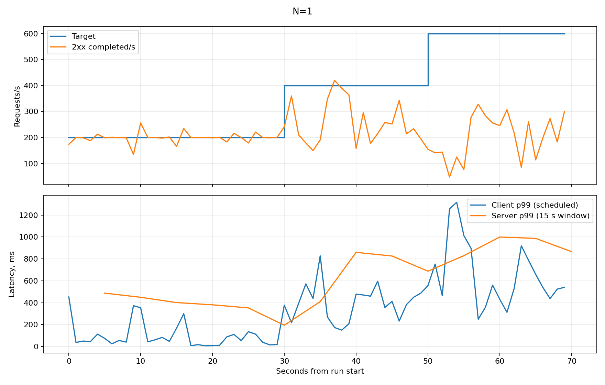
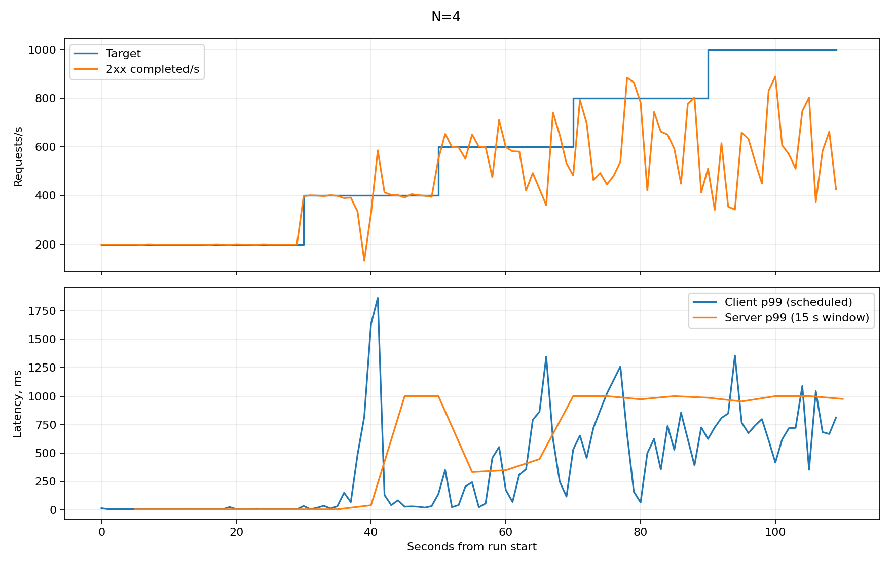
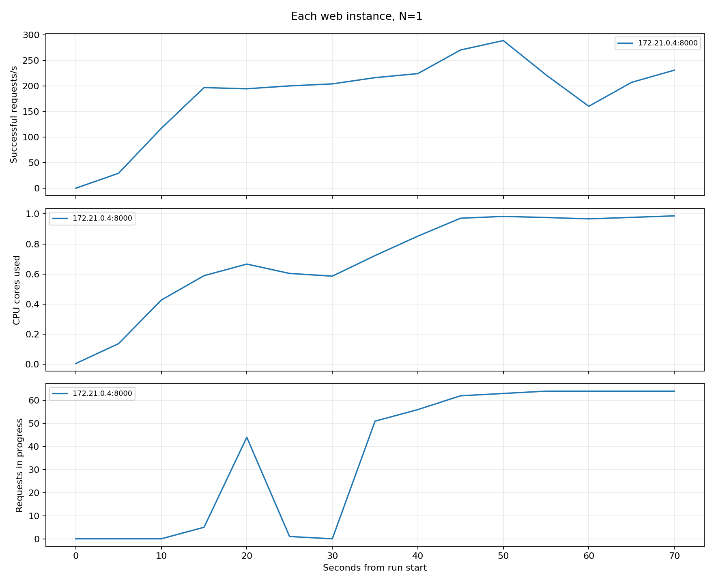
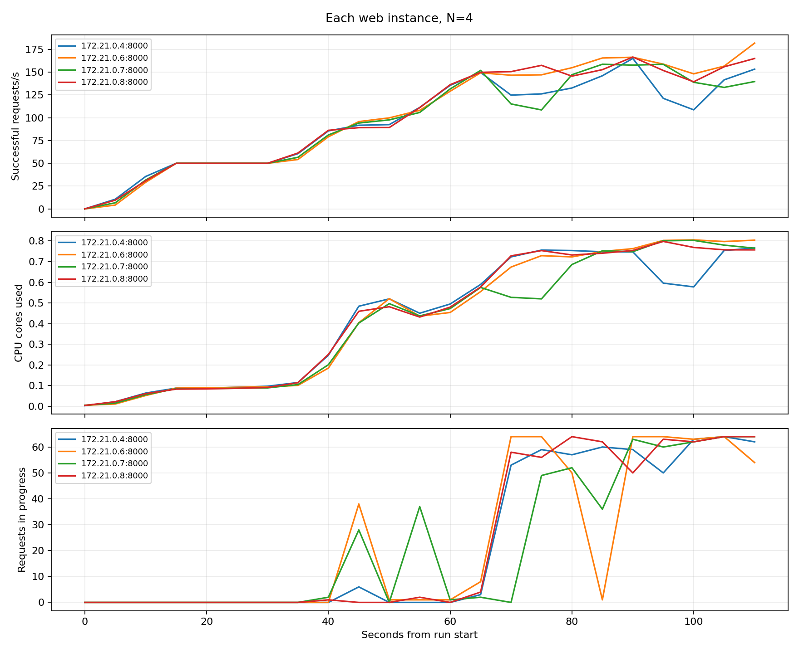
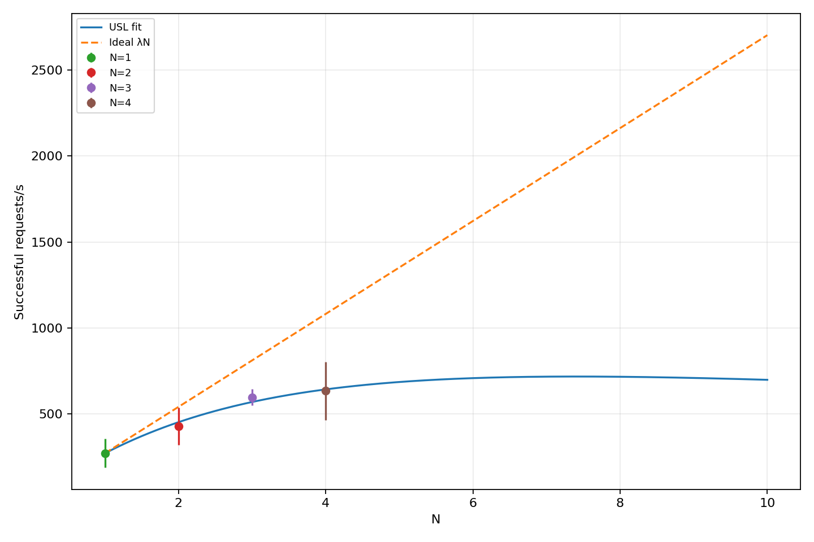
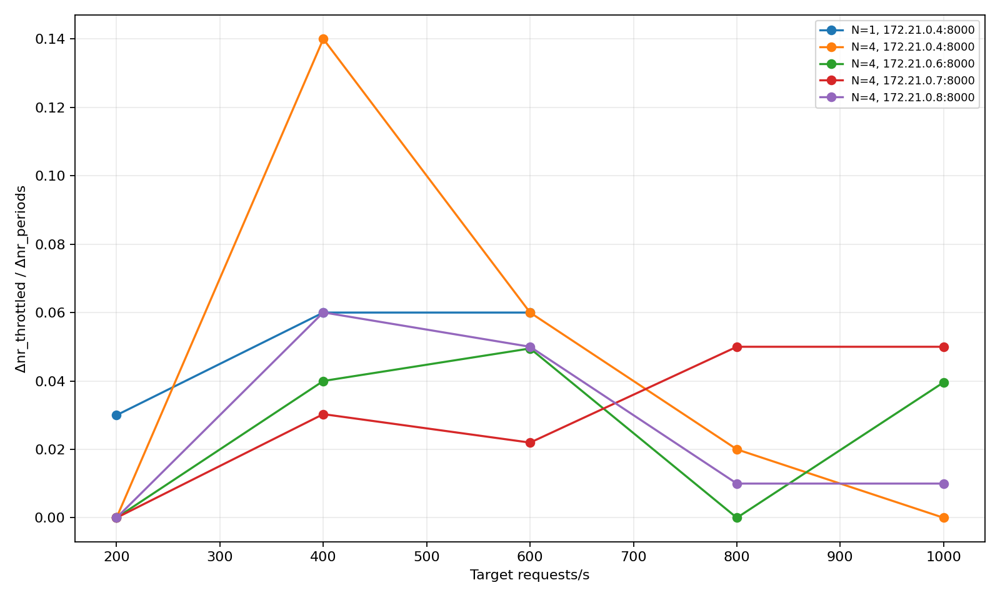

# Лабораторна робота 2 Метрики сервісу і межа масштабованості

Варіант 7. Дьяченко Валерія, група ЗК-61мп.

Дисципліна «Високопродуктивні розподілені обчислювальні системи».

## Мета роботи

До сервісу записів про вакцинацію додано метрики Prometheus. Сервіс перевірено під навантаженням на одному, двох, трьох і чотирьох екземплярах. Для кожного запуску визначено швидкість обробки запитів, а за результатами розраховано параметри універсального закону масштабованості.

За результатами запусків швидкість зросла з 270.333 до 633.867 успішних відповідей за секунду. Четвертий екземпляр дав приріст лише 6.22% відносно трьох. Під час запуску процесор комп’ютера був майже повністю зайнятий.

## 1 Перенесення сервісу та умови експерименту

З першої роботи перенесено таблицю `vaccinations` і CRUD API `/vaccinations`. Збережено поля запису, фільтр за вакциною, пагінацію та правила: номер дози від 1 до 4, дата введення не пізніше поточної. Дані залишаються у PostgreSQL, схема створюється автоматично на порожньому томі. Для другої роботи використано окремий проєкт Compose `vaccinations-pr2`; файли першої роботи в її репозиторії не змінювалися.

Два worker Gunicorn замінено одним процесом Starlette/Uvicorn. За умовою в контейнері має працювати один процес сервісу. Також це спрощує вимірювання його CPU. Запити до PostgreSQL виконуються через асинхронний пул.

| Параметр | Значення |
|---|---|
| Комп’ютер генератора | Windows, 8 логічних CPU, приблизно 6.96 ГіБ оперативної пам’яті |
| Docker Desktop | 8 CPU, 3.311 ГіБ пам’яті |
| Docker Compose | v5.6.0 |
| Ліміт кожного web | 1.5 CPU, 1 ГіБ пам’яті |
| Процесів сервісу на контейнер | 1 |
| Максимум з’єднань PostgreSQL на web | 15 |
| Межа одночасних CRUD-обробників на web | 64 |
| Генератор | 2 процеси з асинхронним HTTP-клієнтом |
| Сценарій | GET `/vaccinations/101` через Nginx |
| Сервер і генератор | На одному фізичному комп’ютері |

Перед серією додано 100 записів з ідентифікаторами 101–200, які збережено в `results/seed.json`. Для читання використано запис 101 із цього набору. Нумерація почалася зі 101, оскільки база зберегла записи попереднього запуску; таблиця перед серією не очищувалася.

Початковий ліміт 1.5 CPU збережено для всіх чотирьох прогонів. Зменшувати CPU і повторювати серію не знадобилося: генератор встигав надсилати запити в основних прогонах і виконав критерії завдання.

## 2 Метрики та обробка запитів

Метрики створюються один раз при запуску застосунку. На початку кожного запиту збільшується лічильник активних запитів. Після відповіді він зменшується, а код відповіді й час обробки записуються в метрики. Мітка шляху для читання одного запису має вигляд `/vaccinations/{id}`. ID окремих записів у мітку не додаються. Завдяки цьому Prometheus не зберігає окремий ряд для кожного запису.

| Метрика | Призначення |
|---|---|
| `http_requests_total{method,path,code}` | Кількість завершених відповідей за методом, шаблоном шляху і кодом |
| `http_request_duration_seconds` | Гістограма часу обробки запиту сервером |
| `http_requests_in_progress{path}` | Кількість запитів, які ще обробляються |
| `process_cpu_seconds_total` | Накопичений процесорний час сервісу |
| `cgroup_cpu_nr_periods_total` | Кількість періодів квоти CPU контейнера |
| `cgroup_cpu_nr_throttled_total` | Кількість періодів з обмеженням CPU |
| `service_info{pod}` | Ім’я екземпляра для зіставлення з адресою цілі Prometheus |

Для варіанта 7 використано бакети Г1: **5, 10, 25, 50, 100, 250, 500, 1000 мс**. У метриках вони записані в секундах. Самі звернення до `/metrics` не включаються в гістограму HTTP. Запити готовності мають власну мітку шляху та не змішуються з `/vaccinations/{id}` у розрахунках навантаження.

`GET /livez` повертає 200 без звернення до PostgreSQL. `GET /healthz` виконує `SELECT 1`; при недоступності бази повертається 503. Заголовок `X-Pod` додається до кожної відповіді: значення береться з `POD_NAME`, а за відсутності змінної — з імені хоста контейнера.

Для кожного екземпляра створюється один `AsyncConnectionPool` з `max_size=DB_POOL_SIZE`; у Compose задано 15. З’єднання понад цей максимум не відкриваються. Для чотирьох web верхня межа становить 60 з’єднань. Перед виконанням SQL перевіряються обов’язкові поля, тип дози, дата та рядкові значення. Керівні символи в рядкових полях заборонено. Некоректні дані повертають 400; недоступність з’єднання або перевищення часу очікування пулу — 503.

Кількість одночасних CRUD-обробників обмежено 64 на екземпляр. Коли всі обробники зайняті, новий запит отримує 503 з повідомленням `Черга запитів заповнена`. Такі відповіді враховано в колонці неуспішних запитів. Задана інтенсивність генератора не зменшується. `/metrics`, `/livez` і `/healthz` проходять окремо від цієї черги. Nginx не повторює відповіді 503 на іншому web, щоб не створювати додаткових запитів під час перевантаження.

## 3 Prometheus і пошук екземплярів

Стенд складається з PostgreSQL, web, Nginx і Prometheus. Дані бази та Prometheus зберігаються у різних іменованих томах. З комп’ютера доступні Nginx на порту 18081 та Prometheus на порту 19090. Порти web і бази доступні лише всередині Docker.

Налаштування збору:

```yaml
global:
  scrape_interval: 5s
  scrape_timeout: 4s
  evaluation_interval: 5s
scrape_configs:
  - job_name: web
    metrics_path: /metrics
    dns_sd_configs:
      - names: [web]
        type: A
        port: 8000
        refresh_interval: 5s
```

Після зміни кількості web перезапускався балансувальник. Навантаження починалося після того, як Prometheus знаходив усі потрібні екземпляри. Відповідь API Targets для чотирьох екземплярів збережено в `results/cpu-1.5/targets-4.json`:

| Ціль | Екземпляр за X-Pod | Стан |
|---|---|---|
| `172.21.0.4:8000` | `1b60a105b1e7` | UP |
| `172.21.0.6:8000` | `9057c30da552` | UP |
| `172.21.0.7:8000` | `b27888bc8a8e` | UP |
| `172.21.0.8:8000` | `6a1e2f932d2e` | UP |

## 4 Ступінчастий профіль і спосіб обчислення

Генератор працює у двох процесах. Між ними розподілено спільний розклад запитів. Для відправки використано `aiohttp`. Кожен запит надсилається у запланований час, без очікування відповіді на попередній. Ліміт з’єднань клієнтського пулу вимкнено. На Windows після пробудження таймера повторно перевіряється годинник, щоб не відправити запит раніше запланованого моменту.

Прогрів триває 10 с на 200 rps. Далі йдуть сходинки по 20 с: 200, 400, 600 rps і так далі. Перші 5 с кожної сходинки відкидаються. Прогін завершується після двох сходинок поспіль зі швидкістю нижче 90% заданої або після досягнення межі генератора G.

Для кожної секунди записуються ціль, фактична відправка, кількість 2xx, не 2xx, тайм-аутів і помилок з’єднання, а також p50, p95 і p99. Затримка клієнта відраховується **від запланованого моменту** до повного читання відповіді. Тайм-аут — 5 с; тайм-аут зараховується до неуспішних відповідей.

Для розрахунку X(N) взято лише успішні 2xx-відповіді, отримані за останні 15 с сходинки. Із 15 посекундних значень береться середнє; X(N) — найбільше таке середнє за прогін. Розкид — вибіркове стандартне відхилення цих самих 15 значень. Клієнтські перцентилі у підсумковій таблиці обчислені за відповідями, завершеними в тому самому вікні. Для кожного N виконано один ступінчастий прогін; повторні прогони не усереднювалися.

Початкові дані запитів збережено у `results/cpu-1.5/run-N.json`, посекундні таблиці — в `seconds-N.csv`. Таблиці в `RESULTS.md` і графіки розраховано скриптом `scripts/analyze.py`.

## 5 Калібрування генератора

Калібрування виконано через той самий порт Nginx на `/noop`. Для цього шляху балансувальник повертає 204, не звертаючись до web. Усього збережено 762000 відповідей 204, помилок у цьому прогоні не було.

| Ціль, rps | Досягнуто, rps | Відправлено, rps | p95 відставання від розкладу, мс |
|---|---|---|---|
| 200 | 200.000 | 200.000 | 1.719 |
| 800 | 800.000 | 800.000 | 1.177 |
| 1600 | 1600.133 | 1600.000 | 1.181 |
| 2400 | 2399.933 | 2400.000 | 25.684 |
| 2600 | 2598.200 | 2599.067 | 17.682 |
| 2800 | 2671.200 | 2681.933 | 613.119 |
| 3000 | 2818.133 | 2817.600 | 2481.993 |
| 3200 | 3039.533 | 3033.133 | 3610.992 |
| 3400 | **3138.267** | 3149.933 | 6084.483 |
| 3600 | 2620.867 | 2624.800 | 9044.074 |
| 3800 | 1839.000 | 1843.667 | 12550.689 |

Найбільша середня швидкість під час калібрування становила **G = 3138.267 rps**. Саме це значення за умовою прийнято за межу генератора. Після 3600 і 3800 rps обидві сходинки дали менше 90% цілі, тому калібрування завершилося.

На високих сходинках генератор уже запізнювався з відправкою. Тому він не підтримував стабільні 3400 rps, хоча на цій сходинці отримано найбільшу швидкість відповідей G. Для основних прогонів це не стало обмеженням: найбільша задана швидкість була 1000 rps, а p95 відставання відправки в усіх чотирьох прогонах не перевищив 8.532 мс. Для порівняння з критерієм завдання `0.9G = 2824.440 rps`, що значно вище за всі отримані X(N).

## 6 Пропускна здатність на 1–4 екземплярах

| N | X(N), rps | Розкид, rps | Сходинка максимуму, rps | p99 клієнта, мс | p99 сервера, мс | Не 2xx, % | CPU одного web, ядер | Запити в обробці на web |
|---|---|---|---|---|---|---|---|---|
| 1 | 270.333 | 84.010 | 400 | 634.576 | 688.047 | 32.686 | 0.983 | 60.333 |
| 2 | 427.800 | 108.469 | 600 | 676.585 | 880.512 | 28.732 | 0.938 | 62.667 |
| 3 | 596.733 | 46.576 | 600 | 374.828 | 472.642 | 0.533 | 0.774 | 17.000 |
| 4 | 633.867 | 168.497 | 800 | 910.938 | 985.781 | 21.233 | 0.753 | 51.500 |

CPU у цій таблиці — середнє по екземплярах значення `rate(process_cpu_seconds_total[15s])` наприкінці вибраного вікна. Значення 1 відповідає одному повністю зайнятому ядру. Запити в обробці усереднено за 15 с і за web. Нижче також наведено знімок `docker stats`. Він показує навантаження в один момент, тому його значення можуть відрізнятися від середніх у таблиці.

Приклад для одного екземпляра: на сходинці 400 rps за останні 15 с завершено 4055 відповідей 200, тому `X(1)=4055/15=270.333 rps`. У тому самому вікні було 1969 відповідей 503: `1969/(4055+1969)×100%=32.686%`.

В основних прогонах отримано тільки коди 200 і 503. Усі 503 містили пояснення про заповнену чергу; тайм-аутів, помилок з’єднання та 504 у цій серії не зафіксовано. Отже, помилок з’єднання не було, але частина запитів отримала відмову 503, як показано в таблиці.

| N | Остання ціль, rps | Досягнуто на останній сходинці, rps | 90% цілі | Точка обмежена генератором |
|---|---|---|---|---|
| 1 | 600 | 227.267 | 540 | Ні |
| 2 | 800 | 353.933 | 720 | Ні |
| 3 | 1000 | 394.667 | 900 | Ні |
| 4 | 1000 | 619.000 | 900 | Ні |

Усі X(N) нижчі за 0.9G, а останні сходинки не утримували 90% цілі. Тому для розрахунку моделі використано всі чотири результати.

З трьома web швидкість 600 rps майже втримано: 596.733 rps та 0.533% неуспішних відповідей. Четвертий web підняв максимум до 633.867 rps, але на цій сходинці помилки становили 21.233%. Отже, на сходинках із найбільшою швидкістю успішних відповідей частина запитів уже завершувалася помилками.

## 7 Розподіл запитів і часові діаграми

Кількість відповідей пораховано за `X-Pod` у сирих запитах. У таблиці використано всі вимірювані сходинки; відповіді, завершені під час прогріву та після кінця профілю, не включено.

| N | X-Pod | Відповідей |
|---|---|---|
| 1 | `1b60a105b1e7` | 23988 |
| 2 | `1b60a105b1e7` | 19926 |
| 2 | `9057c30da552` | 19928 |
| 3 | `1b60a105b1e7` | 20402 |
| 3 | `9057c30da552` | 19872 |
| 3 | `b27888bc8a8e` | 19589 |
| 4 | `1b60a105b1e7` | 14365 |
| 4 | `6a1e2f932d2e` | 15243 |
| 4 | `9057c30da552` | 15242 |
| 4 | `b27888bc8a8e` | 14687 |

Для чотирьох екземплярів на кожен припало приблизно 24.1–25.6% відповідей. Навантаження отримували всі web. Логи знято з `--since` для кожного прогону окремо; у `lb-4.log` перші й останні часові мітки належать саме серії на чотирьох екземплярах.

На рисунках наведено посекундну задану та досягнуту інтенсивність. p99 клієнта показано за секунду, а p99 сервера — за ковзне вікно 15 с з кроком 5 с. Перші 10 с — прогрів, який не входить у підсумкові X(N).



Один web уже на 400 rps не встигав обробляти всі запити. Перехід до 600 rps не підняв її: середнє зменшилося з 270.333 до 227.267 rps. Одночасно зросла затримка та частка відмов.



Чотири web краще справлялися з меншим навантаженням, але на 800 і 1000 rps теж не встигали за заданою швидкістю. Посекундні значення сильно коливалися, що видно і за розкидом X(4) у 168.497 rps.





На високих сходинках кількість запитів в обробці наближається до встановленої межі 64. Після заповнення черги нові запити отримують 503. Через це кількість активних обробників далі не зростає.

## 8 Порівняння p99 і похибка гістограми

Для кожної сходинки на одному web використано прирости бакетів за останні 15 с, просумовані по екземплярах. Значення `increase` можуть бути дробовими: Prometheus оцінює приріст за все вікно, використовуючи окремі моменти збору метрик.

| Ціль, rps | p99 клієнта, мс | p99 сервера, мс | Бакет сервера, мс | Максимальна похибка, мс |
|---|---|---|---|---|
| 200 | 271.188 | 194.255 | (100, 250] | 150 |
| 400 | 634.576 | 688.047 | (500, 1000] | 500 |
| 600 | 837.506 | 866.094 | (500, 1000] | 500 |

Приклад для 400 rps: загальний приріст `_count` становив 5991.896759, ранг `r=0.99×5991.896759=5931.977791`. До межі 0.5 с накопичено 5895.858343 спостереження, до 1 с — 5991.896759. Тому:

`Q(0.99)=0.5+(1−0.5)×(5931.977791−5895.858343)/(5991.896759−5895.858343)=0.688047 с`.

На 200 rps клієнтський p99 вищий за серверну оцінку на 76.933 мс. На 400 і 600 rps гістограмна оцінка сервера, навпаки, вища за клієнтську. Різниця 53.471 і 28.588 мс менша за ширину бакета 500 мс. Така різниця пов’язана зі способом розрахунку. Серверний p99 оцінюється за інтервалами гістограми, а клієнтський — за часом кожного запиту. Межі часових вікон також трохи відрізняються через періодичний збір метрик.

У цих трьох підсумкових вікнах p99 не потрапив у +Inf. Для інших вікон, де ранг перевищував останню скінченну межу Г1, серверний результат слід читати як `> 1000 мс`; верхня похибка там не обмежена.

## 9 Параметри універсального закону масштабованості

Використано модель:

`X(N)=λN/[1+σ(N−1)+κN(N−1)]`, де `λ=X(1)=270.333333 rps`.

Для N>1 обчислено `C(N)=X(N)/X(1)`, `u=N−1`, `v=N(N−1)` та `y=N/C(N)−1`.

| N | C(N) | u | v | y |
|---|---|---|---|---|
| 2 | 1.582491 | 1 | 2 | 0.263830 |
| 3 | 2.207398 | 2 | 6 | 0.359066 |
| 4 | 2.344760 | 3 | 12 | 0.705932 |

Отримані суми: `Σu²=14`, `Σv²=184`, `Σuv=50`, `Σuy=3.099758043`, `Σvy=11.153239220`.

Знаменник: `D=14×184−50²=76`.

`σ=(184×3.099758043−50×11.153239220)/76=0.167019986`.

`κ=(14×11.153239220−50×3.099758043)/76=0.015229565`.

Обидва коефіцієнти вийшли додатними, тому додатковий перерахунок не знадобився.

`N*=√((1−σ)/κ)=√((1−0.167019986)/0.015229565)=7.3956`.



За моделлю найбільша швидкість очікується при N*≈7.40. Але вимірювання виконано тільки для N=1…4. Запусків на семи або восьми web не було, тому цей прогноз ще потрібно перевірити. Для N=1, N=2 та N=4 швидкість помітно коливалася навіть у межах одного прогону, що також впливає на точність моделі.

Якби швидкість зростала прямо пропорційно кількості екземплярів, вона дорівнювала б λN. Фактичний результат для чотирьох екземплярів становить: `633.866667/(4×270.333333)=0.58619`, тобто 58.62% ідеального значення.

## 10 Дроселювання CPU і спільний ресурс

Для варіанта М3 читаються `nr_periods` і `nr_throttled` із `cpu.stat`. Частка дроселювання за вікно обчислюється як `Δnr_throttled/Δnr_periods`.



Для одного web на сходинках 200, 400 і 600 rps отримано відповідно 3%, 6% і 6% періодів з дроселюванням. Для чотирьох web у вікні X(4) значення становили:

| Екземпляр | Частка періодів дроселювання |
|---|---|
| `1b60a105b1e7` | 2% |
| `9057c30da552` | 0% |
| `b27888bc8a8e` | 5% |
| `6a1e2f932d2e` | 1% |

Збільшення навантаження не завжди збільшувало частку дроселювання. Наприклад, для першого web на сходинці 400 rps у прогоні N=4 було 14%, а на 800 rps — 2%. Це частка періодів з хоча б одним обмеженням, а не відсоток втраченого процесорного часу.

Нижче наведено один знімок ресурсів із 15-секундного вікна, у якому отримано X(4). CPU 100% у `docker stats` відповідає одному ядру.

| Контейнер | CPU | Використана пам’ять |
|---|---|---|
| web-1 | 91.11% | 32.70 МіБ |
| web-2 | 92.36% | 32.37 МіБ |
| web-3 | 91.94% | 32.78 МіБ |
| web-4 | 89.79% | 32.18 МіБ |
| PostgreSQL | 72.20% | 133.40 МіБ |
| Nginx | 54.56% | 64.00 МіБ |
| Prometheus | 0.49% | 25.38 МіБ |

Генератор разом із дочірніми процесами використав 93.90% CPU та сумарно 182.34 МіБ RSS. CPU всього хоста в цьому знімку був зайнятий на **96.90%**. Інші знімки в тому самому вікні дали 99.70% і 99.30%.

Найімовірніше, подальше зростання швидкості обмежував процесор комп’ютера: він був майже повністю зайнятий. На ньому одночасно працювали web, база, Nginx, генератор і Windows. При додаванні web усі вони продовжували ділити той самий процесор. Пам’яті вистачало: жоден web не наблизився до ліміту 1 ГіБ. У вікні X(4) один web у середньому використовував 0.753 ядра з дозволених 1.5, а дроселювання становило 0–5%. Тому пояснювати результат лише лімітом CPU контейнера було б недостатньо. Окремого вимірювання, яке показало б обмеження саме в PostgreSQL, не виконано.

## 11 Перевірка SIGTERM

Після основної серії запущено два web і постійне навантаження 200 rps. Один контейнер зупинено під час цього прогону. Використано команди:

```sh
docker compose ps -q web
docker stop --time 35 <container_id>
docker inspect --format '{{.State.ExitCode}}' <container_id>
```

Код завершення за `docker inspect` — **0**. У збереженому журналі сервісу є:

```text
INFO:     Shutting down
INFO:     Waiting for application shutdown.
INFO:     Database pool closed; shutdown complete
INFO:     Application shutdown complete.
INFO:     Finished server process [1]
```

У вікні п’ять секунд до початку `docker stop` і п’ять після нього перевірено 2002 запити. Усі отримали 200; відповідей не 2xx і помилок з’єднання не було. У повному 30-секундному прогоні також збережено 6000 відповідей 200. Дані перевірки — `results/graceful-check.json` і `results/graceful.json`.

CMD записано в exec-формі: `CMD ["python", "server.py"]`. SIGTERM отримує сам процес сервісу. Сервер припиняє приймати нові з’єднання, очікує завершення активних обробників до 25 с, після чого закриває пул з’єднань із базою. `stop_grace_period` становить 35 с. Після завершення сервер повторно не передає SIGTERM процесу. Завдяки цьому після штатної зупинки зберігається код 0.

## Рішення під час реалізації

Не залишено два worker Gunicorn із першої роботи: друга робота вимагає один процес, а метрики CPU повинні відповідати саме процесу сервісу. Обрано один асинхронний сервер і один пул з’єднань на екземпляр.

Не використано конкретні ID у мітках Prometheus. Для таблиці з новими записами це збільшувало б кількість часових рядів, хоча вимірюється одна операція читання. Замість цього використано шаблон `/vaccinations/{id}`.

Не залишено стандартний ліміт з’єднань клієнтського HTTP-пулу. Він міг би обмежувати число одночасних запитів раніше за сервіс. Генератор має `limit=0`, а його фактична відправка перевіряється окремо.

Не використано необмежену чергу CRUD-обробників. Встановлено 64 одночасні обробники на web; надлишок отримує явний 503. Це дозволяє бачити заповнення черги за кодами відповідей і не накопичувати тисячі обробників у процесі.

## Висновок

У роботі додано метрики й перевірено, як кількість екземплярів впливає на швидкість сервісу. Для кожного наступного запуску отримано такі максимальні швидкості успішних відповідей: 270.333, 427.800, 596.733 і 633.867 rps. Прискорення для чотирьох web становило 2.345 раза. Від трьох до чотирьох web швидкість зросла лише на 6.22%, тоді як p99 на вибраному максимумі піднявся з 374.828 до 910.938 мс, а частка 503 — з 0.533% до 21.233%.

Результати вказують на обмеження процесора спільного комп’ютера: у вікні X(4) його завантаження становило 96.9–99.7%. Нові контейнери ділили процесор із рештою програм. Метрика М3 показала, що результат не можна пояснити лише квотою CPU окремих web. Запасу пам’яті було достатньо.

Підібрано σ=0.167020 та κ=0.015230. Модель дає N*≈7.40, але цей прогноз виходить за межі виконаних запусків N=1…4. Під час перевірки SIGTERM сервіс завершив роботу з кодом 0. У перевіреному вікні до та після зупинки помилок не було.

