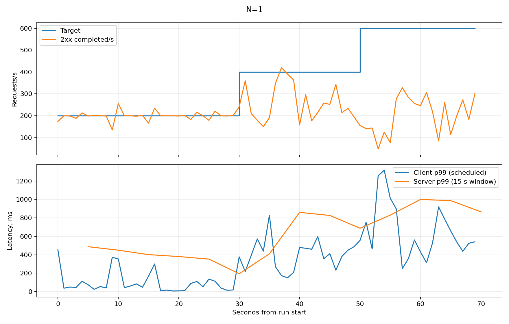
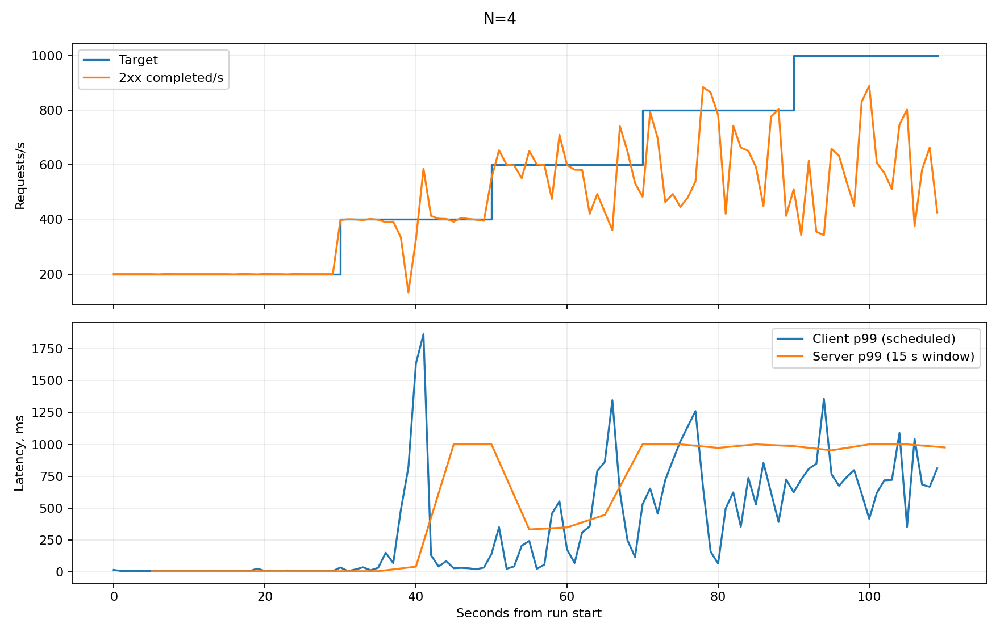
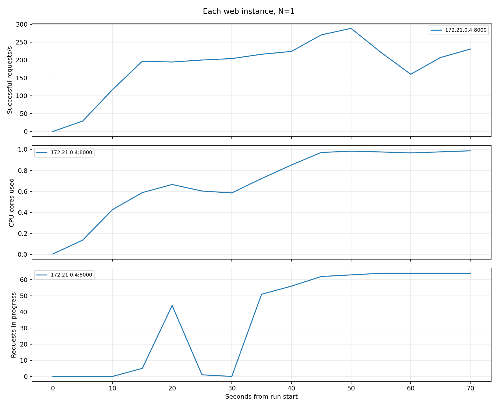
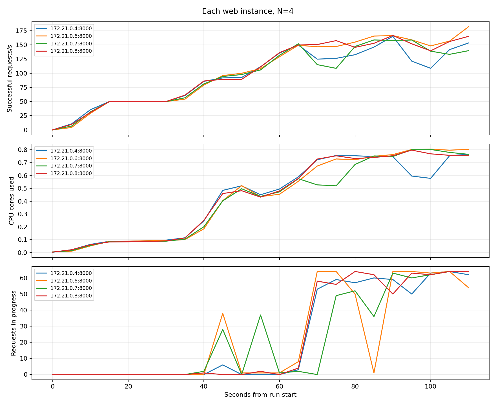
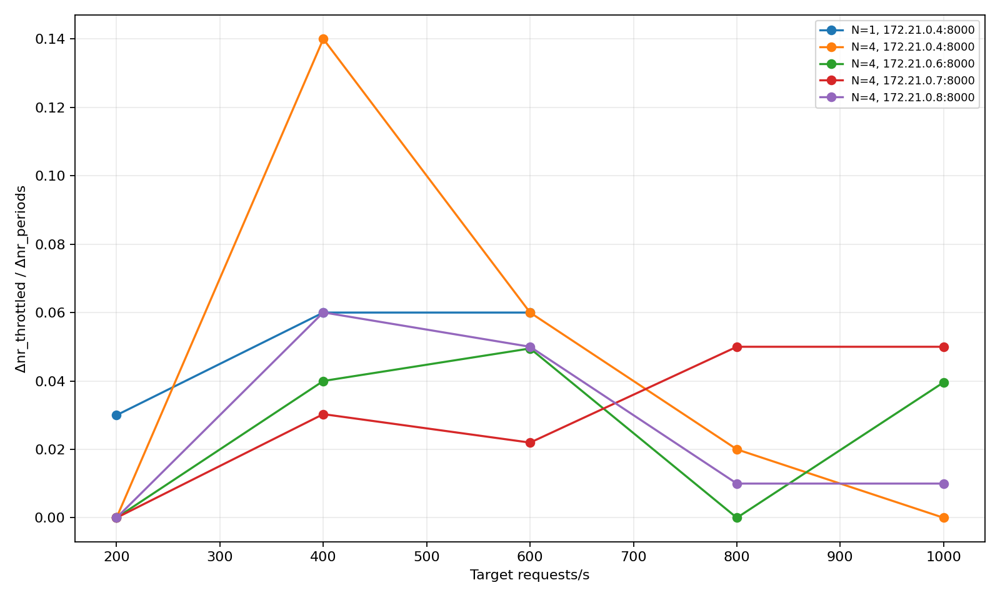
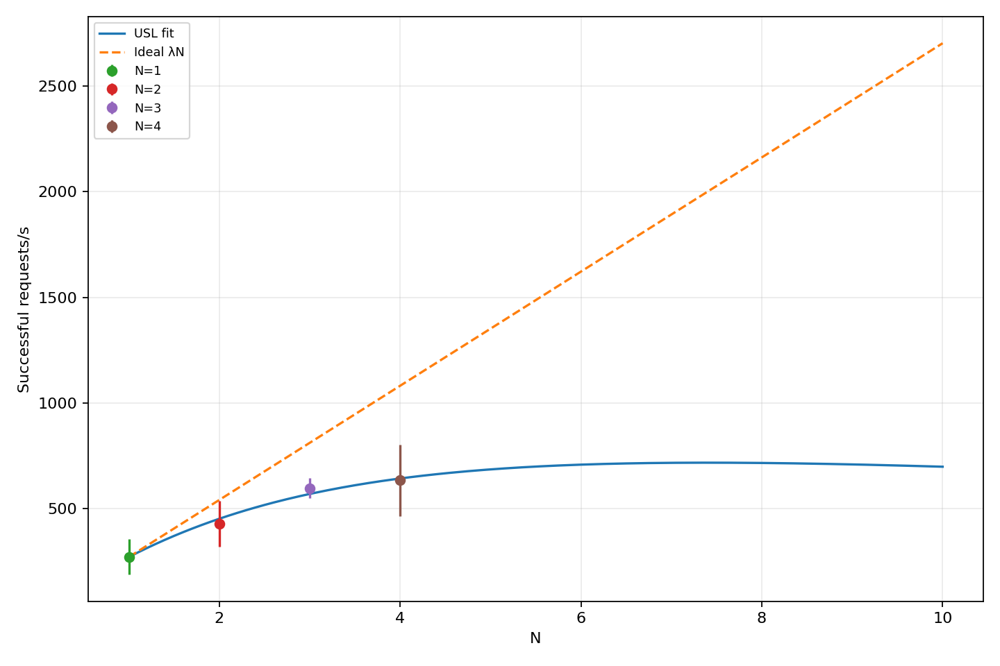

# Числові результати лабораторної роботи 2

Межа генератора G = 3138.267 rps. Ліміт web = 1.5 CPU; пам’ять = 1 ГБ; пул = 15.

| N | X(N), rps | Стандартне відхилення, rps | Сходинка, rps | p99 клієнта, мс | p99 сервера, мс | Не 2xx, % | Помилки з’єднання | CPU на web, ядер | Запити в обробці на web | Обмежено генератором |
|---|---|---|---|---|---|---|---|---|---|---|
| 1 | 270.333 | 84.010 | 400 | 634.576 | 688.047 | 32.686 | 0 | 0.983 | 60.333 | ні |
| 2 | 427.800 | 108.469 | 600 | 676.585 | 880.512 | 28.732 | 0 | 0.938 | 62.667 | ні |
| 3 | 596.733 | 46.576 | 600 | 374.828 | 472.642 | 0.533 | 0 | 0.774 | 17.000 | ні |
| 4 | 633.867 | 168.497 | 800 | 910.938 | 985.781 | 21.233 | 0 | 0.753 | 51.500 | ні |

## p99 за сходинками одного екземпляра

| Ціль, rps | p99 клієнта, мс | p99 сервера, мс | Бакет, мс | Максимальна похибка, мс |
|---|---|---|---|---|
| 200 | 271.188 | 194.255 | (100.000, 250.000] | 150.000 |
| 400 | 634.576 | 688.047 | (500.000, 1000.000] | 500.000 |
| 600 | 837.506 | 866.094 | (500.000, 1000.000] | 500.000 |

## Кількість відповідей на кожен екземпляр

Підрахунок виконано за X-Pod у всіх отриманих відповідях вимірюваних сходинок; прогрів виключено.

| N | Екземпляр | Відповідей |
|---|---|---|
| 1 | `1b60a105b1e7` | 23988 |
| 2 | `1b60a105b1e7` | 19926 |
| 2 | `9057c30da552` | 19928 |
| 3 | `1b60a105b1e7` | 20402 |
| 3 | `9057c30da552` | 19872 |
| 3 | `b27888bc8a8e` | 19589 |
| 4 | `1b60a105b1e7` | 14365 |
| 4 | `6a1e2f932d2e` | 15243 |
| 4 | `9057c30da552` | 15242 |
| 4 | `b27888bc8a8e` | 14687 |

## Підбір USL

Формула: X(N)=λN/[1+σ(N−1)+κN(N−1)], λ=X(1).
Для N>1: C=X(N)/X(1), u=N−1, v=N(N−1), y=N/C−1.

| N | C(N) | u | v | y |
|---|---|---|---|---|
| 2 | 1.582491 | 1 | 2 | 0.263830 |
| 3 | 2.207398 | 2 | 6 | 0.359066 |
| 4 | 2.344760 | 3 | 12 | 0.705932 |

u2 = 14.00000000.

v2 = 184.00000000.

uv = 50.00000000.

uy = 3.09975804.

vy = 11.15323922.

denominator = 76.00000000.

σ₀=(184.00000000×3.09975804−50.00000000×11.15323922)/76.00000000=0.16701999.
κ₀=(14.00000000×11.15323922−50.00000000×3.09975804)/76.00000000=0.01522956.
Після перевірки невід’ємності: σ=0.16701999, κ=0.01522956, λ=270.333 rps.
N*=√((1−0.16701999)/0.01522956)=7.3956.

## Ресурси

Docker: 8 CPU, 3.311 ГіБ пам’яті.

Знімок docker stats з 15-секундного вікна X(4):

| Контейнер | CPU | Пам’ять |
|---|---|---|
| vaccinations-pr2-web-4 | 89.79% | 32.18MiB / 1GiB |
| vaccinations-pr2-web-3 | 91.94% | 32.78MiB / 1GiB |
| vaccinations-pr2-web-2 | 92.36% | 32.37MiB / 1GiB |
| vaccinations-pr2-web-1 | 91.11% | 32.7MiB / 1GiB |
| vaccinations-pr2-lb-1 | 54.56% | 64MiB / 3.311GiB |
| vaccinations-pr2-db-1 | 72.20% | 133.4MiB / 3.311GiB |
| vaccinations-pr2-prometheus-1 | 0.49% | 25.38MiB / 3.311GiB |

Генератор разом із дочірніми процесами: CPU 93.900% (100% = одне ядро), сумарний RSS 182.336 МіБ.

Використання CPU всього хоста: 96.900%.

## Графіки

